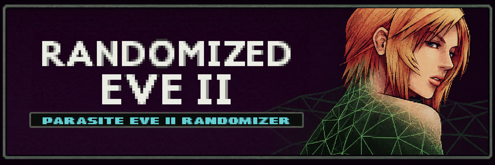
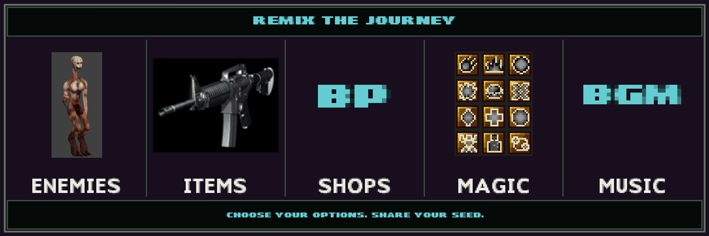
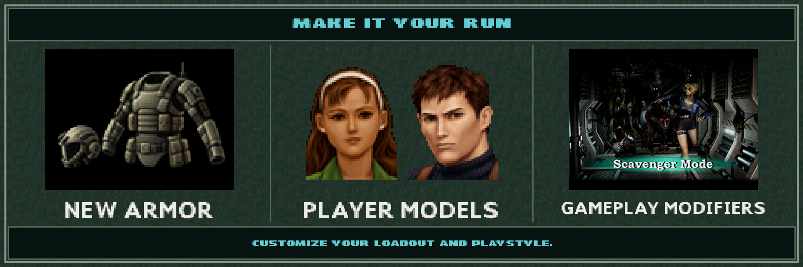

# Randomized Eve II



[](https://github.com/Minivozhd/randomized-eve-ii/releases/tag/v1.3.0)
[](https://discord.com/invite/ybyPJYyswW)

A desktop randomizer for **Parasite Eve II (USA / NTSC-U)**. It randomizes enemies,
items, shops, magic and music, and supports optional armor, character and gameplay
modifiers. Users supply their own supported original BIN/CUE pair for **both discs**.

**[Download for Windows, macOS or Linux](https://minivozhd.github.io/randomized-eve-ii/)**
— ready-to-run packages, installation notes and checksums are available on the
download page and in [GitHub Releases](https://github.com/Minivozhd/randomized-eve-ii/releases).

## Make each playthrough your own



Choose enemy and item pools, tune drop probabilities and shop prices, shuffle
music and magic, and configure your starting equipment. Save the seed and settings
in an INI to revisit a run or share its configuration. For identical randomized
content, use the same release and platform build; standard-library differences
can change the results across platforms.



Enable **113 new armors**, select alternate player models and matching portraits,
and adjust the HUD and gameplay modifiers. Nine male characters include Kyle,
Rupert, Douglas and Pierce, with compatible animations and Kyle's wound/death
voices. Optional modifiers include mixed Cloak GOLEM encounters, Rupert's revolver
sound, Kyle's P229, Active Time Battle and inventory access during combat.

The illustrations above summarize features; they are not gameplay screenshots.
See [README.txt](README.txt) for player instructions and the complete changelog.

## Build from source

This repository contains the C++20 application, compiled patch data, CMake
configuration and C++ tests for **1.3.0 (13 October 2026)**.
It does not depend on the original development checkout, Python, a MIPS compiler,
asset generators, an emulator, or a decompilation project.

### Quick start

Requirements:

| Component | Requirement |
| --- | --- |
| Compiler | C++20; Clang, GCC or MSVC |
| Build system | CMake 3.27 or newer; Ninja for the included presets |
| GUI | wxWidgets 3.2 or newer, core and base components |
| QR code library | libqrencode |
| Tests | The same C++ compiler; no additional test framework |

From this directory:

```sh
cmake --preset release
cmake --build --preset release --parallel 4
ctest --preset release
```

Or run all three steps with `cmake --workflow --preset release`.
Use `debug` instead of `release` for a debug build. `core` builds the library and
ROM-free tests without wxWidgets or libqrencode:

```sh
cmake --workflow --preset core
```

For an application-only build, pass `-DBUILD_TESTING=OFF` during configuration.
To reject compiler warnings, pass `-DPE2_WARNINGS_AS_ERRORS=ON`.
No dependencies or private files are downloaded by CMake.

## Platform setup

### Windows x64

The repository's Windows CI uses **MSYS2 UCRT64**. In the UCRT64 shell, install:

```sh
pacman -S --needed mingw-w64-ucrt-x86_64-gcc \
  mingw-w64-ucrt-x86_64-cmake mingw-w64-ucrt-x86_64-ninja \
  mingw-w64-ucrt-x86_64-pkgconf mingw-w64-ucrt-x86_64-wxwidgets3.2-msw \
  mingw-w64-ucrt-x86_64-qrencode
```

Run the quick-start commands in that same shell. Do not mix MSYS, MINGW64 and
UCRT64 libraries. MSVC can also be configured from a developer shell with matching
wxWidgets and libqrencode libraries supplied through `CMAKE_PREFIX_PATH`.
GitHub Actions builds the application and runs its tests on Windows, macOS and Linux.

To create a portable folder containing the EXE, DLLs, UI artwork and README:

```sh
cmake --install build/release --prefix dist/windows --strip
```

The complete application is in `dist/windows/bin/`. Copy that whole folder,
not just the EXE. Do not add the source tree or build files to the portable ZIP.
Avoid semicolons in the destination path. The game patch payloads are embedded
in the EXE; only two GUI image files remain in `resources/assets/`.

### macOS and Linux

For local development on macOS with Homebrew:

```sh
brew install cmake ninja wxwidgets qrencode
```

On Linux, install the compiler, CMake, Ninja, wxWidgets development headers,
libqrencode development headers and pkg-config from your distribution.
The GUI target is `build/release/pe2randomizer` on Linux. On macOS, CMake places
the application in `build/release/pe2randomizer.app`.

On macOS, `cmake --install build/release --prefix dist/macos` creates a self-contained
app with its dependent libraries. The release provides separate Apple Silicon and
Intel ZIPs. These community builds are ad-hoc signed, not Apple-notarized.

On Ubuntu 24.04, install `libwxgtk3.2-dev libqrencode-dev ninja-build pkg-config dpkg-dev`,
then build a native package with:

```sh
cpack --config build/release/CPackConfig.cmake -G DEB -B dist
```

The DEB uses system dependencies managed by apt. For other current x86-64
Linux distributions, including Arch-based systems such as CachyOS, use the
AppImage. It bundles wxWidgets, GTK and libqrencode and requires glibc 2.39 or
newer. There is currently no Flatpak or Flathub release.

```sh
chmod +x Randomized-Eve-II-v1.3.0-x86_64.AppImage
./Randomized-Eve-II-v1.3.0-x86_64.AppImage
```

If FUSE is unavailable, use the runtime's extraction mode:

```sh
./Randomized-Eve-II-v1.3.0-x86_64.AppImage --appimage-extract-and-run
```

CI tests the AppImage on Ubuntu and in an Arch Linux container without installed
wxWidgets or libqrencode. This checks startup, bundled libraries and resource
lookup; it does not replace testing generation on the user's desktop.

`cmake/PackageAppImage.sh` packages an installed AppDir (with a `usr/` prefix)
on Ubuntu 24.04. It needs linuxdeploy's GTK build dependencies, ImageMagick,
patchelf and curl; see the workflow for the full package list. It downloads a
checksum-pinned linuxdeploy and a commit-pinned GTK plugin. Refresh the checksum
explicitly if the upstream continuous linuxdeploy asset is replaced. The script
does not publish anything. The manual AppImage workflow can also package the
verified DEB from an existing release without rebuilding or retagging its code.

Dependencies outside the default search paths can be selected with
`-DCMAKE_PREFIX_PATH=/path/to/dependencies` or a local, ignored
`CMakeUserPresets.json`. Never commit machine-specific paths.

## Repository layout

```text
assets/                 Two GUI images: background and application icon
cmake/                  Build, install and resource-staging definitions
src/delivery/           Generation coordinator and external configuration
src/domain/             Game catalogues, formats and randomization logic
src/ui/                 wxWidgets interface and settings serialization
src/utils/              File operations, compression, geometry and logging
src/resources/          Compiled-in game data and a read-only resource API
src/patches/            Compiled MIPS patch tables and C++ patch applicators
tests/                  C++ regressions and opt-in local integration tools
docs/                   Architecture, patch contracts, tests and known issues
README.txt              Player instructions and the complete release changelog
```

There are no Python files, ROMs, saves, development utilities, patch compilers,
prototype boss assets, or build outputs in this source folder. CMake presets put
new build products under the ignored `build/` directory.

## Tests and patch data

- `ctest --preset release` runs the **ROM-free** regression suite. Assertions remain
  active even in Release builds. Each test has a label and a timeout.
- `ctest --preset release -L mips` executes the saved armor machine-code patches
  in a bounded MIPS-I test interpreter, including branch and load delay slots.
- `ctest --preset release -L resources` verifies every embedded release payload
  and resource lookup/staging behavior.
- Full disc generation and encounter enumeration are **explicit opt-in** tools;
  they require user-owned game files and are not silently run by CTest.

See [Testing](docs/TESTING.md) for coverage, commands and limitations,
[Patch data](docs/PATCHES.md) for storage and validation contracts, and
[Architecture](docs/ARCHITECTURE.md) for the generation flow.

## Development conventions

Use the existing `src/` modules, project-root include paths and `.hpp` headers.
The `.clang-format` file defines the common C++ style. Build the application and
its tests against the same `pe2_core` implementation. Avoid preprocessor constants
that can collide with identifiers in another namespace. New patch data belongs
in the embedded catalogue or an existing C++ patch table, with a corresponding
regression and updated fingerprints.

The project version remains **1.3.0** until an explicit release decision. Preserve
existing settings serialization and random-number consumption during refactoring.
The same seed is not guaranteed to produce identical drops across different C++
standard-library implementations; compare like-for-like toolchains.

## Known limitations

Passing compilation, synthetic tests, or a disc byte comparison does not prove
that every encounter plays correctly. [Known issues](docs/KNOWN_ISSUES.md) records
remaining gameplay checks, including the reported shooting-range level 2+ exit
freeze. Original PlayStation hardware validation is separate from host tests.
The unfinished boss-encounter prototype and debug weapon inventory are excluded;
reserved old settings are rejected before generation can modify working files.

ROMs, BIOS files, saves and decompilation sources are not included. This is an
unofficial fan project; game-derived resources and third-party libraries remain
the property of their respective owners. See [third-party notices](THIRD_PARTY_NOTICES.md).

## Credits and release history

Original project and release credits: **Strog** and **TheVozhd**.

Special thanks to **[GabeRealB](https://github.com/GabeRealB)** for
the **[Parasite Eve II decompilation](https://github.com/GabeRealB/parasite-eve-2-decomp)**.
This work has been an invaluable reference for understanding the game's internals
and developing the randomizer's patches. Thank you for making it available to
the community.

The release changelog is maintained only in [README.txt](README.txt).
Community: <https://discord.com/invite/ybyPJYyswW>.
